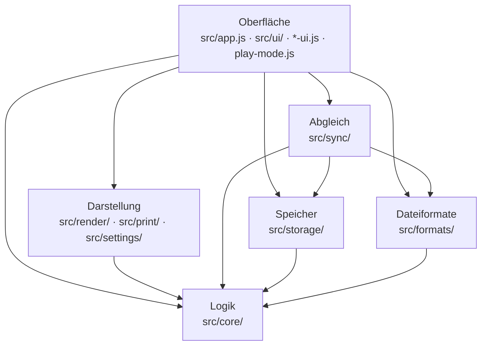
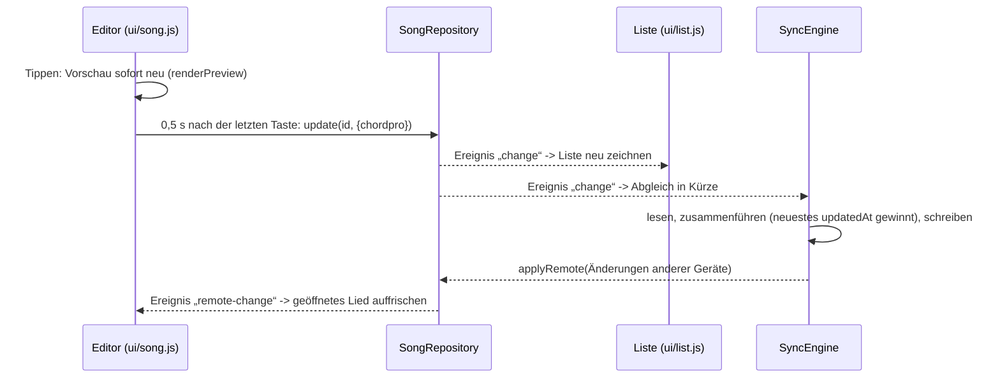

# Architektur

Wie das Liederbuch aufgebaut ist und wie die Teile zusammenspielen. Die Beschreibung jeder einzelnen
Funktion steht in der [API-Dokumentation](api/README.md), die aus den Kommentaren im Quelltext erzeugt wird.

## Grundsätze

- **Einfacher Aufbau.** Reines JavaScript (ES-Module) ohne Framework. [Vite](https://vite.dev) ist
  Entwicklungsserver (`npm run dev`) und baut die App für die Veröffentlichung (`npm run build` → `dist/`).
  Bibliotheken nur, wo sie echte Arbeit sparen.
- **Offline zuerst.** Alle Lieder liegen im Browser (IndexedDB). Die Cloud ist ein Abgleich, kein Muss.
- **Lesbare Dateien.** Lieder sind ChordPro-Text – in der App, auf dem WebDAV-Server und in der Sicherung.
- **Logik ohne Bildschirm.** Alles, was rechnet (Parser, Transponieren, Dateiformate, Abgleich), kommt ohne
  DOM aus und ist mit Tests abgesichert (`tests/`).

## Schichten

Abhängigkeiten zeigen nur nach unten. Ein Modul darf alles darunter benutzen, nie etwas darüber.



| Schicht | Ordner | Aufgabe |
|---|---|---|
| Logik | `src/core/` | ChordPro lesen, Akkorde transponieren, Capo, Harp-Tabs, Wiederholungen, Liedinfo im Text ändern, Sortieren, Spielmodus-Rechnungen, Textfunktionen |
| Dateiformate | `src/formats/` | `.cho`-Dateien und Dateinamen, ZIP, Sicherung, Import von Text und Ultimate Guitar, Export als Text |
| Speicher | `src/storage/` | Lieder und Setlisten in IndexedDB; weiches Löschen (Papierkorb), Export/Import |
| Abgleich | `src/sync/` | Sync-Engine (zusammenführen), Anbieter Google Drive, Dropbox und WebDAV, Google-Anmeldung |
| Live-Modus | `src/live/`, `src/live-ui.js` | kleiner MQTT-Client (WebSocket), Raum-Code und AES-GCM-Verschlüsselung, Live-Raum über zwei öffentliche Server; Dialog und Mitsinger-Ansicht im Spielmodus |
| Darstellung | `src/render/`, `src/print/`, `src/settings/` | Lied -> HTML, Griffbilder, Seitenumbruch für den Druck, Darstellungs-Einstellungen |
| Oberfläche | `src/app.js`, `src/ui/`, `src/*-ui.js`, `src/play-mode.js` | alles, was man sieht und anklickt |

## Datenmodell

**Lied** (IndexedDB, Speicher `songs`) – Beschreibung aller Felder in [`types.js`](api/types.md):

```js
{ id, chordpro,                 // der Liedtext – die einzige „Wahrheit“
  title, artist, sortTitle, tags, // daraus abgeleitet (für Liste und Suche)
  transpose, accidentals, note,  // Ansicht und private Notiz
  createdAt, updatedAt, deletedAt }
```

**Setliste** (Speicher `setlists`): `{ id, name, items: [{ songId, transpose, note }], createdAt, updatedAt, deletedAt }`.

Gelöscht wird **weich**: `deletedAt` wird gesetzt, der Datensatz bleibt als „Grabstein“, damit der Abgleich die
Löschung an andere Geräte weitergeben kann. Im Papierkorb lässt er sich wiederherstellen.

**Song-Modell** (Ergebnis von `parseChordPro`, Aufbau im Kopf von [`core/chordpro.js`](api/core/chordpro.md)):
`meta` (Titel, Interpret, Tonart …) und `blocks` (Abschnitte mit Zeilen aus Akkord-/Text-Segmenten).

## Ein Lied bearbeiten – was passiert



## Abgleich

Die **Sync-Engine** (`sync/sync-engine.js`) kennt nur zwei Dinge vom Anbieter: `read()` und `write()`.
Sie liest den Stand in der Cloud, führt ihn mit dem eigenen zusammen (pro Datensatz gewinnt das neuere
`updatedAt`, Löschungen sind Grabsteine) und schreibt das Ergebnis zurück. Hat sich die Cloud inzwischen
geändert (`ConflictError`), liest sie neu und versucht es noch einmal.

| Anbieter | Ablage | Besonderheit |
|---|---|---|
| Google Drive (`google-drive.js`, Anmeldung `google-auth.js`) | eine JSON-Datei pro Liederbuch | Teilen über Drive-Freigaben (lesen/bearbeiten); Google setzt die Rechte durch, mit Leserechten gleicht die Engine nur ab (`readOnly`) |
| WebDAV (`webdav.js`, `webdav-client.js`) | `Lieder/*.cho`, `Setlisten/*.txt`, `Liederbuch.json` nur als Hinweis | Dateien auch direkt auf dem Server bearbeitbar; jedes Gerät merkt sich, welche Dateien es gesehen hat, und erkennt so Umbenennen und Löschen |

## Mehrere Liederbücher

`books.js` führt die Liederbücher eines Geräts: das persönliche (`PERSONAL`), eigene (`own`, ab 2.2),
geteilte (`shared`, Drive-Datei eines anderen) und Abos. Jedes hat eine eigene IndexedDB (`dbName`);
`ui/app-state.js` öffnet nur die des aktiven Buchs, ein Wechsel lädt die Seite neu. Das persönliche
lässt sich umbenennen (`personalName`, `personalBookName()`). Oberfläche: Dialog `#books-dialog`
(Liste, anlegen, Einladung, Abo) in `books-ui.js` und `#sync-dialog` (Abgleich des geöffneten Buchs) in
`sync-ui.js`; `setupSync` richtet beide ein und reicht dem Liederbuch-Teil nur, was er von der Cloud braucht. Speicherort,
Zugangsdaten und Anmeldung liegen je Buch unter `bookKey(book, 'webdav.url')` usw. (gelesen über
`sync/book-settings.js`) – für das
persönliche und vor 2.2 geteilte Bücher sind das die alten, globalen Schlüssel (keine Umstellung),
sonst `…:<Buch-ID>`. `GoogleAuth` (`tokenKey`, `accountKey`, `login_hint`), `DropboxProvider`
(`tokenKey`, `path`) und `GoogleDriveProvider` (`fileName`, `fileIdKey`) bekommen diese Schlüssel von
`sync-ui.js`; so hat jedes Buch sein eigenes Konto.

## Abos (private Gruppen)

Ein abonniertes Liederbuch ist ein eigenes Liederbuch (`books.js`: `abo: { url, … }`, eigene Datenbank)
mit `readOnly` (`ui/app-state.js`). Es wird nie mit der Cloud abgeglichen, sondern über die Abo-Datei:
`sync/abo-client.js` lädt sie (Anmeldung, ETag), `SongRepository.replaceFromAbo` übernimmt den Stand
(die eigene Notiz bleibt; Transposition und Schreibweise kommen vom Herausgeber, sobald er sie ändert). Veröffentlichen (`ui/publish.js`) schreibt die Datei
(`formats/abo.js`, lesbares JSON) in den WebDAV-Ordner oder zum Herunterladen.

## Oberfläche

`src/app.js` steckt nur zusammen. Gemeinsamer Zustand liegt in [`ui/app-state.js`](api/ui/app-state.md):
Liederbuch, Datenbanken (`repo`, `sets`), das geöffnete Lied (`state.current`) und die größeren Bereiche
(`services.printer`, `services.play`, `services.setlists`).

Module verständigen sich über **Ereignisse** statt sich gegenseitig zu importieren:

| Ereignis | Wo | Bedeutung |
|---|---|---|
| `songopened` | `window` | ein anderes Lied ist geöffnet (Liste markiert es, Setlisten passen sich an) |
| `change` | `repo`, `sets` | Lieder/Setlisten geändert (Liste neu zeichnen, Abgleich anstoßen) |
| `remote-change` | `repo`, `sets` | Änderungen von anderen Geräten angekommen |
| `settingschange` | `window` | Darstellungs-Einstellungen gespeichert |
| `metronome-beat` | `window` | Schlag des Metronoms (Anzeige blinkt) |

Gespeicherte Werte pro Gerät (localStorage) laufen über [`prefs.js`](api/prefs.md), Tastenkürzel über
[`ui/shortcuts.js`](api/ui/shortcuts.md) – beides jeweils an einer Stelle mit Standardwerten bzw. Tabelle.

## Gestaltung (CSS)

- `src/render/song-view.css` – das Lied selbst; alle Werte als CSS-Variablen (Schrift, Farben, Abstände),
  die `settings/settings.js` setzt.
- `src/styles/*.css` – die Oberfläche, eine Datei pro Bereich. Die Reihenfolge der `<link>` in `index.html`
  zählt: Grundlagen zuerst, Bereiche danach.
- `src/print/print.css` – nur für den Druck.

Vor und nach CSS-Umbauten mit [`tools/css-snapshot.js`](../tools/css-snapshot.js) vergleichen.

## Offline und Installation

`src/pwa.js` meldet den Service Worker (`public/sw.js`) an – nur in der gebauten App; beim Entwickeln
wird er abgemeldet, damit keine alten Dateien aus dem Cache kommen. Strategie „Netz zuerst, sonst Cache“: Mit Verbindung
kommt immer die neueste Version, ohne Verbindung die zuletzt geladene. Es gibt keine Dateiliste zu pflegen.

## Tests und Dokumentation

| Was | Wie |
|---|---|
| Tests | `npm run dev`, dann http://localhost:5173/tests/ öffnen |
| API-Dokumentation | `python tools/make-docs.py` erzeugt `docs/api/` aus den Kommentaren |
| Fehlende Kommentare finden | `python tools/make-docs.py --check` |

## Kommentare schreiben

Über jede exportierte Funktion, Klasse und öffentliche Methode gehört ein JSDoc-Kommentar (ähnlich Doxygen):

```js
/**
 * Einen Ton um Halbtöne verschieben.
 * @param {string} note      z. B. 'F#' oder 'Bb'
 * @param {number} steps     Halbtöne (auch negativ)
 * @param {boolean} useFlats mit b statt # schreiben
 * @returns {string}
 */
export function transposeNote(note, steps, useFlats) { … }
```

Oben in jeder Datei erklären ein paar `//`-Zeilen, wofür das Modul da ist – daraus entsteht die Übersicht.
